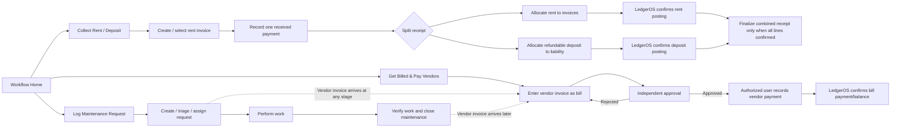
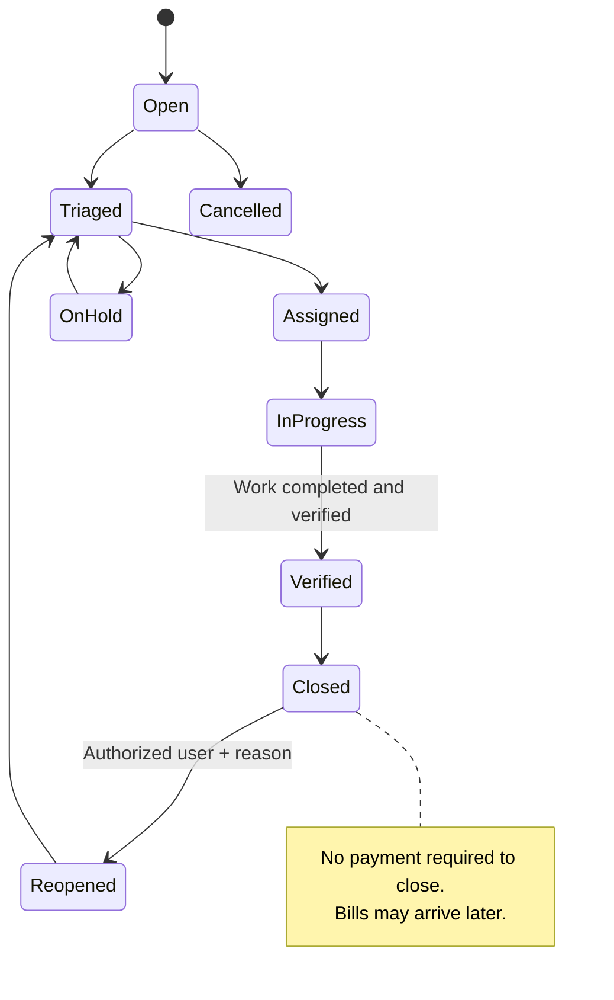
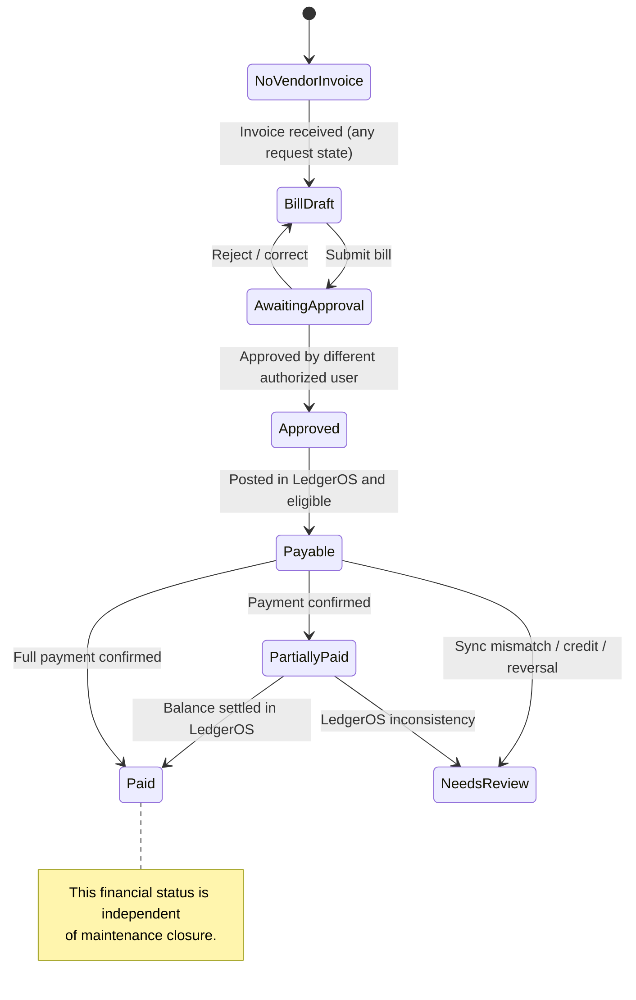

# PropertyLedger PRD: Workflow Home, Rent Collection, Vendor Payables, and Maintenance

**Version:** 1.0 — Product decisions incorporated  
**Date:** October 20, 2026  
**Repository:** [timolingh/propertyledger](https://github.com/timolingh/propertyledger) (baseline: `main`, reviewed October 20, 2026)  
**Owner:** Product owner  
**Status:** Product decisions Q1–Q16 recorded. **Codex may prepare an implementation plan; accounting-contract verification and the bounded technical questions in §14 must be resolved before affected financial mutations are implemented.**  
**Related material:** Original workflow-oriented landing-page PRD, workflow state diagram and landing-page mockup from design review. Mockups are design direction, not executable specifications.

## 1. Executive summary

Replace the existing module-oriented navigation and role-dependent `/home/` redirect with one workflow-oriented landing page, visible to every signed-in user subject to authorization. The page prioritizes three end-to-end user jobs:

1. **Collect Rent / Deposit** — create and post tenant charges/invoices, record externally received payments, and allocate one receipt across rent and refundable security deposits without double-posting or misclassifying liabilities.
2. **Get Billed & Pay Vendors** — enter and attribute vendor bills, enforce explicit independent approval, then allow separately authorized staff to record payments against eligible approved bills.
3. **Log Maintenance Request** — create, triage, assign, and track maintenance to verified work completion; associate zero or more vendor invoices (including multiple vendors) as invoices arrive; carry linked bills through approval and payment independently of maintenance closure.

The global application navigation will be redesigned as a **persistent collapsible left sidebar**, with a responsive mobile menu. Keep existing pages and routes accessible. LedgerOS remains the accounting system of record; PropertyLedger remains the owner of property-management context and operational state.

This release is **not only a cosmetic home-page redesign**. It includes a new maintenance-request lifecycle, individual permission administration for bill approval and payment, combined rent/deposit receipt support, and corresponding integration safeguards and tests.

## 2. Problem and objectives

### 2.1 Problem

The current UI presents modules (`Invoices`, `Payments`, `Bills`, `Maintenance categories`) rather than the jobs users need to complete. A single job can require navigating multiple pages and interpreting local vs LedgerOS states. The existing role landing mechanism redirects admin users to Setup, property managers/viewers to Reports, and bookkeepers to Payments, preventing a shared workflow start.

### 2.2 Goals

- Offer a single recognizable start point for all user roles, adapted to their permissions.
- Make the three primary workflows easy to start, resume, and follow to an appropriate outcome.
- Show pending action and exception queues with **real, permission-filtered** data only.
- Deliver a complete internal maintenance-request lifecycle with explicit request-to-bill links.
- Separate **operational completion** from **accounts payable status**.
- Require approval of **every vendor bill** before payment, prohibit self-approval, and separate approval and payment authority.
- Safely support **one combined receipt** containing both rent and refundable security deposit components.
- Preserve accounting accuracy, audit trails, authorization, and idempotent retries.
- Keep local non-accounting workflows usable during LedgerOS outages.

### 2.3 Non-goals

- Tenant-facing maintenance portal (deferred but design must accommodate it).
- Payment processor integration, tenant online payments, automated electronic vendor disbursements, or ACH initiation.
- Automatic delivery of rent invoices by email/SMS.
- Full vendor portal, field-service dispatch, procurement/purchase orders, document OCR, or check printing.
- Automatically treating a vendor bill reversal as a maintenance reopening event.
- A general-purpose offline transaction synchronization engine.
- Unrelated refactoring or changes to existing GL/accounting conventions.

## 3. Observed repository baseline

The following were verified from the `main` repository during PRD research; **Codex must re-inspect the checkout before modifying code**.

| Area | Current source / observed behavior | Consequence |
| --- | --- | --- |
| Login/home | `propertyledger/views.py` has `AppHomeRedirectView`; `ledgeros/navigation.py` selects role-configured destinations | Replace `/home/` redirect with shared workflow home and revise tests |
| Global UI | `ledgeros/templates/ledgeros/base.html` renders extensive top-link navigation | Build persistent responsive sidebar in shared template |
| Tenant charges | `ledgeros/models.py` has `TenantCharge`; charge routes in `ledgeros/urls.py` | Reuse existing creation, posting, uniqueness, and sync path |
| Tenant receipts | `payments/models.py` has `TenantPayment` and `TenantPaymentApplication` | Existing full-finalization rules cannot be assumed to support deposit splits |
| Deposits | `payments/models.py` has `SecurityDepositEvent` | Existing separate deposit events need integration review for combined receipts |
| Vendor AP | `VendorBill`, `VendorPayment`, bill-scoped pay view and routes in `payments/` | Reuse posting/payment idempotency and LedgerOS balance checks |
| Maintenance | `MaintenanceCategory` exists, but no reviewed `MaintenanceRequest` lifecycle model/routes | New model, services, UI, migrations, permissions and tests required |
| Bill approval | No independent approval model/workflow established by the reviewed `VendorBill` status enum (`draft`, `ready_to_sync`, `posted`, `voided`) | New approval decision and audited transition needed **without confusing accounting-posted status** |
| Permissions | Role groups defined in `ledgeros/roles.py`; route mixins guard current workflows | Add assignable per-user approval and payment capabilities, server-side enforced |
| LedgerOS | Docs describe separate adapter/API, sync records and idempotency | Preserve service boundary, journal effects and retry identities |

**Accounting invariants from `docs/technical-manual.md`:** LedgerOS owns invoices, bills, payment applications, journals, accounting reports, and posted facts. A tenant receipt allocation to an invoice posts a LedgerOS payment against that invoice; receipt finalization requires all of the applicable invoice allocations to have confirmed successful posting. A vendor bill's actual payable balance and payment eligibility come from LedgerOS, not from guessed local status. An attempted payment may have succeeded upstream even if PropertyLedger timed out: retry the same saved operation/identity, never create a replacement posting.

## 4. Approved product decisions (Q1–Q16)

These answers supersede the unanswered-decision section of the earlier PRD. No assumptions from the old diagram that contradict these answers are authoritative.

| ID | Decision | Approved rule |
| --- | --- | --- |
| **Q1** | Shared landing | **One workflow home for every role**, with visible and executable actions controlled by permissions. |
| **Q2** | Maintenance scope | Implement **complete internal maintenance-request lifecycle now**, including vendor billing/payment handoff. |
| **Q3** | Maintenance closure | Close when work is **completed and verified**; billing and payment remain independently tracked. Do not wait for payment. |
| **Q4** | Multiple vendor bills | **One request may relate to multiple vendors, bills, and payments.** |
| **Q5** | Approval requirement | **Every vendor bill** must be **explicitly approved before payment**. |
| **Q6** | Bill approvers | Admins **designate approvers**. A user **may not approve a bill they submitted**. |
| **Q7** | Payment authorization | Admins **designate payment-authorized users** separately from bill approvers. Permission to approve does not itself confer permission to pay. |
| **Q8** | Rent collection method | **Manual recording only**: record externally received check, Zelle, ACH, cash, etc.; do not initiate transfers. |
| **Q9** | Rent/deposit receipt | **One receipt may contain both** rent and refundable security-deposit components, accounted for separately. |
| **Q10** | Request submitters | **Internal staff only** in this release; design for future tenant-created requests. |
| **Q11** | Bills for vendor payments | **Every vendor payment requires an approved vendor bill**. See legacy/other-payment compatibility requirement in §8. |
| **Q12** | Request fields | Required: **property, description, category, priority**. Optional: unit, tenant, vendor, photos, target completion date, estimated cost. |
| **Q13** | Bill handoff trigger | Create/link a bill **when vendor invoice arrives**, whether before or after work completion. Independent workflows. |
| **Q14** | Reopening | Authorized users may **reopen closed maintenance**, with audit trail; bill credits/reversals change financial state but **do not automatically reopen** maintenance. |
| **Q15** | Navigation | Replace current horizontal navigation with a **persistent collapsible left sidebar**, collapsing to mobile menu. |
| **Q16** | LedgerOS outage | **Degraded/local-first operation**: show outage warning, allow safe local tasks/drafts; disable required LedgerOS posting and show accounting figures as unavailable, not zero. |

### 4.1 Product clarifications implied by decisions

- The word **Collect** describes *recording externally received funds*; do not imply PropertyLedger debits a bank account or sends a payment request.
- Maintenance can be closed with **no bill yet received** or for internal/no-cost work, provided work is verified. A later bill still links to the closed request.
- A request's badge must distinguish **maintenance state** from **financial state** (e.g., `Closed · Vendor bills: $320 outstanding`).
- Approval is a separate control from LedgerOS posting and must be enforced **for every new vendor payment**, including direct links and retries where safe. Previously posted historical transactions must not be rewritten or accidentally reposted.
- A bill may be associated with a maintenance request even while that request is Open/In Progress; no prerequisite that maintenance is completed.

## 5. Target information architecture and landing page

### 5.1 Global navigation

On desktop, a **persistent, collapsible left sidebar**. Suggested groups:

- **Home / Workflows**: Home, Collect Rent / Deposit, Get Billed & Pay Vendors, Maintenance.
- **Records**: Properties, Units, Owners, Tenants, Leases, Charges/Invoices, Vendors.
- **Accounting / Monitoring**: Payments, Vendor Bills, Vendor Payments, Banking, Reports, Security Deposits.
- **Administration**: Setup, Approval/Payment Authorizations, Audit Log, Admin (authorized users only).

Use actual named routes. The sidebar may include groups/collapse controls; it must not drop existing screens. Active nav state and accessible keyboard/focus behavior are required. Mobile menu provides equivalent reachability with focus management. Retain simple top header for branding, active user, logout, and service status; the old row of module links is removed.

**Routing:** Authenticated `/home/` renders the workflow home. Login's existing redirect to `/home/` is retained. Link `Home` to `/home/` for all roles. Preserve `/` or redirect it cleanly to `/home/` for authenticated users while keeping incomplete Setup directly reachable and signposted; avoid redirect loops. Keep existing deep-link URLs/names and legacy role configuration coherent. Explicitly adapt role-redirect tests.

### 5.2 Main content layout

**Heading:** `What would you like to do today?`  
**Subtitle:** `Choose a workflow or resume work that needs attention.`

| Main workflow card | Primary action | Additional actions | Sample queue labels (counts only from real data) |
| --- | --- | --- | --- |
| Collect Rent / Deposit | Create charge/invoice | Record receipt; Deposits; Open invoices | Overdue invoices; receipts needing finalization |
| Get Billed & Pay Vendors | Record vendor bill | Approvals; Approved bills ready to pay; Vendor payments | Bills awaiting approval; unpaid approved bills; payments awaiting confirmation |
| Log Maintenance Request | New request | Maintenance queue; Awaiting vendor bill; Linked invoices | Open/in-progress requests; verified work awaiting bill; linked unpaid bills |

All three cards have equal base prominence for all roles. The same card structure is shown to all; permitted CTAs are enabled, others are absent or clearly disabled with an explanation. Read-only users get view actions where authorized. A disabled action may never be the sole means of navigation into a permitted read-only workflow.

Below cards: **My Work Queues** with real filtered actionable items. Optionally show **Recent Activity** and **Workflow Summary** only after a valid permission-safe data definition exists. Do not implement fake notification badges, fabricated balances, unsourced metrics, a global search service, or charts merely because the earlier mockup pictured them.

### 5.3 Proposed low-fidelity desktop layout

```text
+--------------------+------------------------------------------------------+
| PropertyLedger     | PropertyLedger                      Status  User     |
| [Collapse]         +------------------------------------------------------+
| > HOME             | What would you like to do today?                    |
| > WORKFLOWS        | Choose a workflow or resume work.                   |
|   Collect Rent     |                                                      |
|   Vendor Payables  | +----------------+ +----------------+ +------------+ |
|   Maintenance      | | Collect Rent   | | Get Billed &   | | Log Maint. | |
| > RECORDS          | | / Deposit      | | Pay Vendors    | | Request    | |
|   Properties ...   | | Create Charge  | | Record Bill    | | New Request| |
| > ACCOUNTING       | | Record Receipt | | Approval Queue | | View Queue | |
| > ADMIN            | +----------------+ +----------------+ +------------+ |
|                    |                                                      |
|                    | My Work Queues                Recent Activity (opt.) |
|                    | - Receipts to finalize      - Actual audit events |
|                    | - Bills awaiting approval                         |
|                    | - Maintenance in progress                         |
+--------------------+------------------------------------------------------+
```

Layout at narrow widths: cards stack, tables/queues reflow or scroll responsibly, menu collapses into a mobile drawer. Never rely only on color or icon to communicate status.

### 5.4 Permission UX rules

- Cards themselves remain recognizable to everyone; available actions reflect authorization.
- For each button, check the **same server-side capability** used to authorize the target route/service (never only client-side hiding).
- Read-only roles see authorized queues and details but cannot mutate.
- Approval and vendor-payment capabilities are configurable per user through an admin-managed interface; display granted capabilities to the user without exposing unrelated records.
- Setup readiness/status is discoverable; an incomplete setup cannot be bypassed from the new home.

## 6. Workflow 1 — Collect Rent / Deposit

### 6.1 User journey

1. Start from workflow card and select tenant/lease, existing invoice, or create an appropriate charge.
2. Review/approve/sync invoice using existing service, preserving base-rent period uniqueness and idempotency.
3. Record one **externally received** receipt (check, Zelle, manual ACH, cash, other).
4. Enter allocations: zero or more rent/invoice lines and zero or more refundable deposit components (as allowed by configured lease context). Must sum exactly to receipt amount before **finalized/posted** state.
5. Review allocation destinations and accounting implications, including refundable deposit liability.
6. Post via a safe LedgerOS API contract with stable identities; confirm each posting and the combined receipt's completeness. Retry using original identities when uncertain.
7. Finalized receipt appears once in cash totals and the appropriate rent/deposit ledgers; receipt detail presents line allocations and posted LedgerOS references.

### 6.2 Required state behavior

`Draft receipt → Allocation review → Posting in progress → Confirmed/finalized`, with `Partial/failed/needs reconciliation` exception states. **These are conceptual workflow states**, not instructions to rename existing `TenantPayment` statuses. Only posted transactions contribute to authoritative accounting totals. A partially allocated receipt must not falsely appear posted/fully collected.

A deposit must be a **liability**, not rent revenue or AR settlement. The same amount cannot debit cash twice because both a `TenantPayment` and a `SecurityDepositEvent` were submitted. The combined receipt should have traceable rent and deposit portions; a method based on separate source rows must prevent duplicate cash posting at the LedgerOS layer.

### 6.3 Critical engineering gate: combined receipts

The existing code separately handles invoice payment applications and `SecurityDepositEvent` sync events; it is **not established** that its present LedgerOS endpoints safely support one mixed receipt. Before implementation of mixed posting:

1. Inspect the actual LedgerOS API contract and sample journal behavior for rent collections and deposit-liability receipts.
2. Specify a **single economic receipt identity**, allocation records, journal posting map, reference mappings, and idempotency keys across rent and deposit components.
3. Demonstrate the exact debit/credit treatment with a mixed example. For a $2,000 receipt allocating $1,500 to open rent invoices and $500 to a refundable deposit, the aggregate posting must debit Cash **$2,000 once**, credit AR **$1,500**, and credit Security Deposit Liability **$500** (subject to the real LedgerOS supported accounting events).
4. Define retry, partial-success, full-finalization, and reversal behavior without changing a successfully posted allocation's identity or creating new accounting entries to recover a timeout.
5. If existing LedgerOS APIs do not support this without posting ambiguity, **stop this financial slice and propose the smallest explicit API enhancement**. Do not emulate by posting the same receipt as two unrelated full deposits or bypassing the LedgerOS adapter.

The product decision that combined receipts are required is final; the *mechanism* must be verified, not guessed.

## 7. Workflow 2 — Get Billed & Pay Vendors

### 7.1 User journey

1. Create bill from vendor invoice; select vendor, property and optional unit, expense/maintenance category and amount.
2. Save draft and submit for approval. Bill may relate to a maintenance request or stand alone.
3. Designated approver, who is **not the bill submitter**, explicitly approves the bill. Rejected bills can be corrected and resubmitted.
4. Separately authorized user selects an **approved** bill, verifies LedgerOS posting and payable status/balance, and records a payment by manual check/ACH/card/etc. No payment rail is initiated by PropertyLedger.
5. Preserve the existing bill-scoped pay flow, partial payments, vendor identity, LedgerOS validation, replay protection and retry.
6. Present paid/partial/unpaid/unavailable/needs-review state from LedgerOS, with approval state separately visible.

### 7.2 Approval rules

- Add a **separate approval state** or approval record, e.g. `Draft → Submitted → Approved / Rejected / Withdrawn`. Do not reinterpret `VendorBill.status == posted` as proof of approval.
- Record approver, submitter, timestamps, decision, version/fingerprint of approved financial fields, and audit event.
- Approver must differ from submitter, including administrators. Server-side enforcement required.
- A bill that has been materially changed after approval requires reapproval before payment (subject to existing immutability once posted). Minor non-accounting notes may be treated separately if defined.
- Create payment authorization capability independently of bill approval. Admins designate exact eligible users. An approver does **not** automatically have payment authority and a payment-authorized user does **not** automatically have approval authority.
- Deny **every new vendor payment** against unapproved, rejected, voided, unavailable, fully paid, or inconsistent bills. Payment retries for a saved attempt must preserve current idempotency semantics and avoid a second posting.
- Never trust a button state as authorization; direct POST, API, Django admin, and management-command write paths must share enforcement.

### 7.3 Compatibility with existing payment-related flows

The approved rule applies to **vendor-payment transactions against vendor bills**, including credit-card-funded bill settlements. Existing debt-service payments and credit-card payoff entries are conceptually distinct from making a payment to a vendor and must not be silently reclassified; Codex should inventory affected paths and report necessary compatibility changes. Historic successfully posted vendor payments should remain intact and viewable, with a clear `Legacy / approval not recorded` label if appropriate; do not invent retrospective approvals or alter journal entries.

Payment initiation means **record/post a manually executed payment**, not transmit money. Unless explicitly designed later, do not introduce a future-dated payment scheduler: show `Pay bill` and `Record payment`, not `Send ACH` or a fictional scheduling button.

## 8. Workflow 3 — Maintenance Request through Vendor Billing

### 8.1 New maintenance request record

**Required at creation:** property, description, maintenance category, priority.  
**Optional at creation:** unit, tenant, assigned vendor, photo attachments, target completion date, estimated cost.  
**System-managed:** ID, creator, dates, status, completion verification identity/time, reopen reasons, audit events, linked bills.

Model relationships must enforce that any selected unit belongs to the selected property; if a tenant is chosen, associate it with appropriate property/lease where verifiable. Avoid requiring a unit for building-wide/common-area requests.

Internal staff create requests in this release. Preserve nullable `requested_by`/`source` or equivalent extensible origin metadata suitable for a later tenant portal, but **do not build tenant authentication or self-service** now. Photo support was selected as optional; implement it only through a secure documented storage/validation approach, otherwise flag the storage dependency before shipping a visible upload control.

### 8.2 Operational lifecycle

A proposed minimal canonical lifecycle:

`Open → Triaged → Assigned → In Progress → Completed/Verified → Closed`, with `Cancelled`, `On Hold`, and `Reopened` transitions where needed.

- Authorized staff can triage, assign/change vendor, update progress, complete and verify work, and close/reopen.
- Closing requires verified completion, **not vendor invoicing or payment**.
- Request can close without a bill if work is internal/free or invoice has not arrived.
- On reopen, preserve the history of the previous closure and original associated bills; do not delete any prior audit trail.
- Financial status is computed separately from linked vendor bills: `No bill received`, `Bill awaiting approval`, `Approved/unpaid`, `Partially paid`, `Paid`, `Needs review`, `LedgerOS unavailable`, etc.
- A vendor bill reversal or credit updates the linked financial summary but never implicitly changes operational `Closed` to `Open`.

### 8.3 Maintenance-to-bill linkage

- Staff can **create a new vendor bill from the maintenance request** or link a suitable **existing vendor bill** when the invoice is received, at any maintenance stage (before or after completion/closure).
- A single request supports **multiple vendor bills**, including invoices from multiple vendors, and each bill supports partial/multiple payments through the existing vendor-payment model.
- Opening the bill form may prefill property, optional unit, maintenance category, repair notes and selected vendor; user must review and explicitly save. Do not automatically create an invoice at work completion.
- Linkage is explicit and persistent, with stable request/bill references and audit history; validate property/unit compatibility.
- Do not create duplicate vendor bills when the user returns to the handoff screen, retries a failed save, or refreshes.
- Vendor bill detail links back to related maintenance; maintenance detail shows each bill, approval state, confirmed paid/remaining amounts and any reconciliation errors.
- One vendor bill spanning **multiple different maintenance requests** was not expressly decided. Default to a single optional maintenance-request reference on each bill for the initial design, and document an extension route if users later need cost splitting; **do not assume** many-to-many allocations without business signoff.

### 8.4 Workflow ownership

Maintenance records/verification/history live in PropertyLedger. Bills and their local UI/context live in PropertyLedger but accounting facts are posted only in LedgerOS through its adapter. No financial mutation may bypass existing service boundaries. A request is not an accounting document and must not create a journal on its own.

## 9. Conceptual state diagrams

The diagrams represent **business journeys**, not mandates to duplicate pre-existing model status enums.

### 9.1 Unified workflow view



### 9.2 Independent maintenance and financial states





LedgerOS unavailable is a **display/operational condition** rather than proof of `Unpaid`. Do not allow a UI state shortcut from financial `Unavailable` to payment eligibility.

## 10. Behavior during LedgerOS outages

**Approved degraded mode (Q16=A):**

- Show a clear global connection warning and a nearby health/details link.
- Continue safe, local tasks: create/triage/assign/update/close/reopen maintenance, browse local property data, save vendor bill drafts (where local-only), and save receipt drafts without attempting to confirm posting.
- Disallow **new posting**, bill balance-dependent payments, receipt finalization, and any operation whose correctness requires a live LedgerOS response. Distinguish a previously saved *attempted* payment from a draft; preserve retries/idempotency identity.
- Hide or label LedgerOS-based amounts as **Unavailable**; never replace them with `$0`, `Paid`, `Unpaid`, or stale figures represented as current.
- A queued draft is **not** a posted accounting transaction. Do not add an automatic offline posting queue in this PRD.
- When service returns, allow authorized user to resume normal service-based operations safely, with a clear retry/refresh action and preserved original event identities.
- Setup failure, permissions errors, and LedgerOS outage must appear as distinct messages.

## 11. Functional requirements

### 11.1 Cross-cutting HOME requirements

| ID | Requirement |
| --- | --- |
| HOME-01 | Authenticated `/home/` renders shared workflow landing page for all roles. |
| HOME-02 | Desktop left sidebar is persistent/collapsible; narrow-screen mobile menu exposes equivalent navigation. |
| HOME-03 | Three workflow cards, real CTAs, state-specific next actions, and genuine queues; no fake numbers or dead links. |
| HOME-04 | Permission filtering enforced in views, forms, services, admin, and any API write path. |
| HOME-05 | Read-only/owner views remain usable with no unauthorized write actions. |
| HOME-06 | Setup status and LedgerOS health are clearly visible without displacing the three workflows. |
| HOME-07 | Home GET never creates, posts, reconciles, retries, or mutates accounting state. |
| HOME-08 | Keyboard navigation, accessible labels/focus/contrast, and empty/error/unavailable states. |

### 11.2 Rent/deposit requirements

| ID | Requirement |
| --- | --- |
| RENT-01 | Reuse charge approval/sync, rent period idempotency, and invoice display/selection. |
| RENT-02 | Manually enter receipts for check, Zelle, ACH manual, cash, etc.; no money-movement API. |
| RENT-03 | Single receipt can have invoice and security-deposit portions; allocation totals equal receipt total. |
| RENT-04 | Posting creates correct LedgerOS invoice payment applications and deposit liability effect without double cash recognition. |
| RENT-05 | No finalized receipt until **all** allocation lines are confirmed; never mislabel unapplied funds as posted credit. |
| RENT-06 | Preserve stable identities for failed, timed-out, partial, and retried writes; show reconciliation path. |
| RENT-07 | Exact posting contract validated with LedgerOS before shipping mixed-receipt mutation. |

### 11.3 Vendor AP requirements

| ID | Requirement |
| --- | --- |
| AP-01 | Every new vendor bill follows explicit submit/review/approve-or-reject process. |
| AP-02 | Approver configured by admin and differs from submitting user; decisions audited. |
| AP-03 | Payment permission configured independently per user by admin. |
| AP-04 | No new vendor payment unless related vendor bill is approved, posted, and eligible for amount due. |
| AP-05 | Preserve existing safe bill-scoped payment, partial settlement, credit-card funding treatment and retries. |
| AP-06 | Posting status, approval status, and LedgerOS payable status are distinct in UI and data model. |
| AP-07 | Historic posted payments and other payment types preserved with explicit compatibility strategy. |

### 11.4 Maintenance requirements

| ID | Requirement |
| --- | --- |
| MAINT-01 | Create maintenance request with four required and six optional fields as approved in §4. |
| MAINT-02 | Support staff triage, assignment, progress, completion verification, closure, and audited reopening. |
| MAINT-03 | Completion/verification allows closing independent of invoices and payment. |
| MAINT-04 | Bills may be created/linked on receipt at any maintenance stage, including after closure. |
| MAINT-05 | One request links to multiple vendors/bills, each bill to multiple payments through existing model. |
| MAINT-06 | Bill creation prefills safe context but does not auto-post or auto-pay; existing bill linking avoids duplicates. |
| MAINT-07 | Separate operational and financial statuses. Credit/reversal never auto-reopens maintenance. |
| MAINT-08 | Future tenant-submitted requests remain possible without implementing a tenant portal now. |

### 11.5 Outage and audit requirements

| ID | Requirement |
| --- | --- |
| OPS-01 | Local maintenance operations and drafts remain available when LedgerOS is down. |
| OPS-02 | Accounting figures show unavailable and posting/payment/finalization paths are blocked until safe. |
| OPS-03 | Do not create journals from GET requests, maintain provenance and audit trails, redact sensitive credentials. |
| OPS-04 | All new approval, payment permission, maintenance transition, and bill linkage writes are attributable to an actor. |

## 12. Acceptance criteria and examples

1. **Shared home:** Admin, property manager, bookkeeper, owner viewer, and read-only viewer navigate to one workflow home. Their accessible actions/queues differ by authorization. Setup and existing report/banking screens remain reachable. A mobile menu covers the same routes.
2. **Sidebar regression:** Existing named routes/deep links function. No login redirect loops. Accessibility checks pass for keyboard, focus, semantic headings, and screen-width changes.
3. **Rent-only receipt:** Post $1,500 rent against an eligible invoice; Cash/AR and tenant ledger agree with LedgerOS, with no duplicate postings after resubmission.
4. **Combined receipt:** A $2,000 external receipt with $1,500 rent and $500 refundable deposit results in aggregate debit Cash $2,000, credit AR $1,500, credit deposit liability $500. Display one receipt with two components and stable LedgerOS references. Repeated finalize/retry causes no second cash posting.
5. **Partial/failed receipt:** Force API timeout after first successful line. Resume using stable original identities; do not repost first line. Do not mark complete until both lines confirmed. Accounting reports include only actually posted entries.
6. **Bill approval:** Staff submits $400 vendor bill. Submitter (even if admin with approver capability) cannot self-approve. Different designated approver approves and audit records the decision. An unapproved bill cannot be paid via UI/API/admin.
7. **Payment permissions:** A bill approver without payment authorization cannot pay; a payment-authorized user without bill approval rights can pay an approved eligible bill, but cannot approve it. Direct POST attempts are rejected.
8. **Bill payment:** Pay $150 toward a $400 approved, posted, eligible bill; LedgerOS indicates $250 due. Retry same submission after interruption does not create a duplicate journal. Vendor balance becomes paid only when LedgerOS confirms settlement.
9. **Maintenance multi-vendor:** For a request at a property/unit, link a plumber's $500 bill and a painter's $300 bill. Both appear on maintenance detail with separate approval and payment states; vendor payments link to their proper bills and request.
10. **Independent timing:** Create a maintenance bill **before** work is verified, then finish/close the request while bill remains unpaid. Later receive another invoice and link it to the already closed request without reopening maintenance.
11. **Reopening:** An authorized user reopens a closed request with reason, preserving prior closure/bills and recording audit history. Unauthorized attempts fail. Vendor bill credit/reversal changes financial display but leaves request operationally closed.
12. **No-cost/internal:** Complete and verify internal maintenance without a vendor bill; allow close with a reason/no-external-invoice note.
13. **Outage:** Simulate unavailable LedgerOS. Home warns; maintenance requests and local drafts still save; posting and payments cannot proceed; accounting-derived counts show `Unavailable`, not zero. Retry after recovery does not duplicate past attempts.
14. **No regressions:** Property/unit attribution, existing rent generation, invoice allocation and receipt finalization, deposit events, vendor AP posting, bill balance/retry, owner statements, historical records, role permissions and auditing remain correct.

## 13. Codex implementation plan and verification requirements

### 13.1 Required discovery before code

Read `CLAUDE.md`, `README.md`, `docs/technical-manual.md`, `docs/user-manual.md`, `docs/quick-start.md`, relevant migrations, services, routes and existing tests. Compare this PRD against the checkout and document differences. Confirm supported LedgerOS API contracts and deployment compatibility.

### 13.2 Recommended reviewable work packages

**WP1 — Navigation and workflow home.** Shared `/home/`, sidebar layout, role-aware CTAs and queues, health/readiness, responsive/accessibility tests. All CTAs must work or be explicitly gated until implemented; do not deploy a misleading finished workflow card.

**WP2 — Bill approvals and payment capabilities.** Independent approval audit/state, admin-configured designated approvers and payment-authorized users, approval gates in every payment write path, legacy compatibility/permission tests.

**WP3 — Maintenance lifecycle.** Models/migrations, required fields, authorized services/forms/routes/templates, transitions/audit/reopening/closure, optional photos handling, tests.

**WP4 — Request-to-AP handoff.** Multi-vendor/multi-bill request link, create/link existing bills at any stage, prefill, audit and duplicate prevention, separate financial read state, end-to-end tests.

**WP5 — Combined rent/deposit receipts.** LedgerOS contract proof, receipt-level allocation model or minimal extension, correct journal posting, robust partial success/retry/reconciliation, migration strategy and financial invariant tests. **Do not implement this slice until the posting contract is verified.**

**WP6 — Integration, docs and release.** Real work queues, outage experience, desktop/mobile QA, manuals, migration verification, staging smoke tests, deprecation/rollback notes and handoff.

### 13.3 Engineering constraints

- Use explicit domain services for state-changing operations; Django views/admin/APIs must share the same mutation path.
- No direct LedgerOS database writes, cross-repo ORM imports, or shadow journal records.
- No new mutable accounting fields on already-posted records without well-defined migration/reconciliation.
- Existing LedgerOS scope/permission restrictions, signed submission token checks, CSRF, and idempotency remain operative.
- Preserve existing accounting IDs, audit logs, property/unit attribution and report semantics.
- Prefer minimal, well-documented migrations over speculative abstractions.
- Keep the optional left-sidebar layout coherent across current forms and detail pages, not only the landing page.

### 13.4 Verification (containers only)

```bash
docker compose -f docker-compose.yml run --rm propertyledger-web python manage.py check
docker compose -f docker-compose.yml run --rm propertyledger-web python manage.py makemigrations --check --dry-run
docker compose -f docker-compose.yml run --rm propertyledger-web python manage.py test
make check
```

In a prepared, non-production LedgerOS sandbox, exercise all acceptance scenarios, including forced timeouts, duplicate HTTP submissions and a real service outage. Do not reset or purge actual bookkeeping data. Codex must include the exact commands, test results, and residual risks in its completion report. Update active technical and user manuals; keep archived epic records as historical artifacts.

## 14. Remaining implementation-design questions (not a reopening of Q1–Q16)

The sixteen **product choices are resolved**. The following are bounded technical/design details the repository and API contracts must establish. Codex should propose an answer with code evidence before implementing the affected slice. Product approval is required if a proposal changes scope or economic behavior.

| Topic | Implementation decision to verify | Default boundary / resolution rule |
| --- | --- | --- |
| **Mixed rent/deposit journals** | Does LedgerOS support a shared external receipt identity with invoice allocations and liability posting without double cash recognition? | **Financial release gate.** Provide posting proof and idempotency strategy first. Request smallest adapter/API extension if needed. |
| **Maint. bill allocation** | Should one vendor bill ever be split across multiple maintenance requests? | Not approved. Initially allow multiple bills per request, but at most one request on a bill; flag cost-splitting requirement separately. |
| **Maintenance authority** | Which staff can triage, assign, verify, close, reopen, and link bills? | Reuse established role model; propose explicit permission matrix, with no write permissions for viewers. Bill approval/payment grants remain individually configurable. |
| **Approver administration** | User-level grants UI, revocation, audit, and migration/bootstrap defaults? | Admin-managed. No implicit blanket authorization for bookkeepers/property managers. Define safe initial admin/bootstrap grants and rollout. |
| **Bill approval/posting ordering** | Is bill submitted/approved before or after LedgerOS posting? | Both must be independently visible; payment always requires approval **and** eligible LedgerOS posting. Choose path minimizing existing contract disruption. |
| **Prior vendor transactions** | How do new payment gates coexist with previously posted bills/payments and credit-card payoffs? | Preserve history, do not backfill fictional approvals, and separate vendor bill settlement from card payoff/debt service. |
| **Photos** | Which validated storage backend, size limits, allowed types, malware/URL controls and access restrictions? | Optional field from product decision; no nonfunctional upload widget. Confirm safe implementation in WP3. |
| **Home queue metrics** | Definitions/filter logic, live versus cached counts, upstream outage treatment and performance thresholds? | Show real permission-scoped counts only. Start with outstanding approval, receipts awaiting finalization, active requests and posted bill statuses. Explicit unavailable label for LedgerOS-derived data. |
| **Navigation** | What remains in header vs collapsible nav, remembered collapse state, mobile focus trap, role-filtering? | Left sidebar approved; use accessible, simple server-rendered solution; no unnecessary front-end framework. |
| **Receipt semantics** | Are returns/refunds/reversals or deposit transfers represented within the combined receipt UI? | Preserve existing rules; add only behaviors required for this release; document any deferred post-finalization correction flow. |

No new broad discovery questionnaire is required. If the implementation is blocked by an unresolved **accounting contract**, stop only that work package and report evidence, options, impact and recommendation. Other independent work packages may proceed after normal review.

## 15. Codex kickoff prompt (copy/paste)

> Implement the PropertyLedger workflow-oriented landing page and the three approved workflows using the **PropertyLedger Workflow Home PRD v1.0**. Read `CLAUDE.md`, the active technical/user manuals, existing app code and tests first. Treat §4 Q1–Q16 as product-approved decisions. Produce a file-by-file plan and a dependency/risks table before coding. Implement reviewable work packages without unrelated refactoring. Do not bypass LedgerOS services, posting, permissions, or idempotency. The combined rent/deposit receipt work requires a demonstrated LedgerOS accounting and retry contract **before** its financial mutations are implemented. Add migrations, per-user permissions and audited approval/state transitions as specified. Test all accounting flows in Docker with a compatible LedgerOS sandbox, provide desktop/mobile screenshots, and document any unresolved implementation assumptions. Do not change or push to production without approval.

## 16. Completion deliverables

- File-by-file implementation plan and resolved technical findings from §14.
- Reviewable code changes/migrations (separate PRs or commits by work package where practical).
- Updated desktop/mobile home, sidebar and all three usable workflow paths.
- Complete end-to-end tests including combined rent/deposit journaling and bill approval/payment authorization.
- Updated active documentation, manual QA scenario matrix, rollback/legacy compatibility notes.
- Clear implementation-vs-deferred scope report and actual test evidence.
